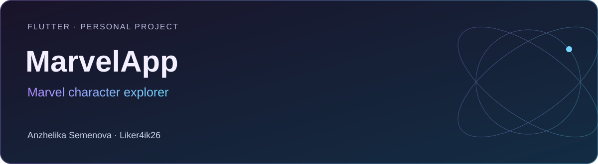

# MarvelApp

**Flutter · Personal project** · Flutter · Dart · BLoC · Dio · GoRouter · GetIt · Firebase Messaging

Приложение для знакомства с героями Marvel: карточки персонажей, подробная информация и переход из уведомления к герою.

[Портфолио автора](https://portfolio.semenova-anzhelika.online/) · [Профиль GitHub](https://github.com/Liker4ik26) · [Исходники](https://github.com/Liker4ik26/flutter_marvel_app/tree/master)

## Как выглядит проект

| Интерфейс | Сценарии |
| :---: | :---: |
| <br/>Экран 1 | <br/>Экран 2 |
| <br/>Экран 3 | <br/>Экран 4 |

[Все изображения проекта](docs/GALLERY.md)

## Что в проекте

- Просмотр персонажей и подробной информации.
- Получение данных через Marvel API и обработка состояний загрузки.
- Кеширование данных и изображений.
- Push-уведомления через Firebase Messaging.
- Светлая и тёмная темы.

## Технологии

| Направление | Реализация |
| :--- | :--- |
| Стек | Flutter · Dart · BLoC · Dio · GoRouter · GetIt · Firebase Messaging |
| Формат | Flutter · Personal project |
| Окружение | Dart >=3.3.4 <4.0.0; совместимый Flutter SDK |

## Где смотреть код

- lib/src/core/ — приложение, навигация и общие стили
- lib/src/ — сценарии и слой данных
- lib/main.dart — инициализация Firebase, API и зависимостей

## Как запустить

Требования: Dart >=3.3.4 <4.0.0; совместимый Flutter SDK.

```bash
git clone --branch master https://github.com/Liker4ik26/flutter_marvel_app.git
cd flutter_marvel_app
flutter pub get
```

Создайте собственный .env с MARVEL_URL, MARVEL_PUBLIC_KEY и MARVEL_PRIVATE_KEY. Подключите свой Firebase-проект для уведомлений. Не добавляйте реальные закрытые ключи в README или публичные коммиты.

```bash
flutter run
```

## English overview

**MarvelApp — Marvel character explorer.**

Flutter · Personal project. Stack: Flutter · Dart · BLoC · Dio · GoRouter · GetIt · Firebase Messaging. [Explore my professional portfolio](https://portfolio.semenova-anzhelika.online/).

---

**Автор — Анжелика Семёнова · [Liker4ik26](https://github.com/Liker4ik26)**

[Сайт](https://portfolio.semenova-anzhelika.online/) · [Telegram](https://t.me/Liker4ik50) · [Почта](mailto:pr110oat18@gmail.com)
